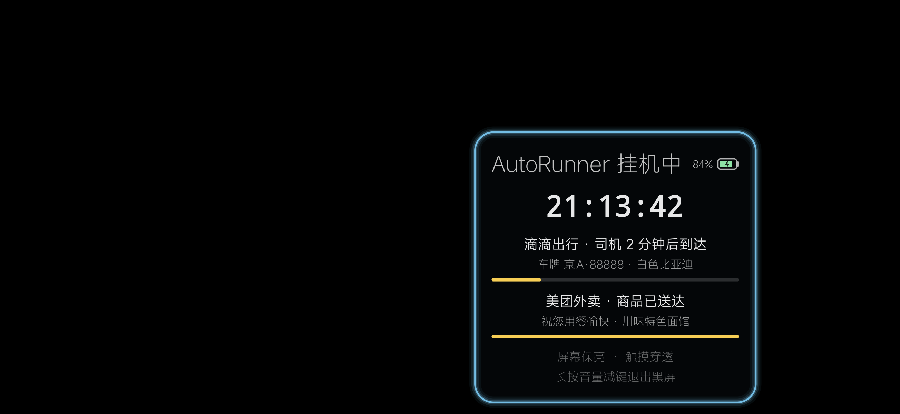

# 小米超级岛 / 焦点通知（开发资料 + 实机核验）

> 采集时间：2026-10-23
> 资料来源：<https://dev.mi.com/xiaomihyperos/documentation/detail?pId=2146> 及其同级/关联文档（`开发文档 / 应用开发 / 服务能力 / 小米超级岛`）
> 实机核验：`25102RKBEC`（myron，HyperOS 4.0.4.0.XPMCNXM / Android 17），已 root（KernelSU）
> 说明：本目录是**离线资料**，所有 `raw/` 文件均由官方页面内嵌的 `__NEXT_DATA__` 正文转换而来，字段含义以官方线上文档为准。

---

## 0. 结论速览

1. **pId=2146 只是《常见 Q&A》**。真正的字段规范在 **pId=2131《开发指南》**，模板样式在《小米超级岛模板库》PDF（112 页，2026-01-29 版）里。
2. 实机是 **OS4.0 / Android 17**，`persist.sys.feature.island = 1`、`notification_focus_protocol = 3` —— 走的是 **OS3 岛通知协议**（OS4 未引入新协议号）。
3. 客户端上岛只需要在**普通原生通知**上塞一个字符串 extra `miui.focus.param`（JSON），不需要新 API、不需要新权限，但**需要平台给应用开通「小米超级岛」服务**，否则按 `filterWhenNoPermission` 降级。
4. 实机抓到了**正在上岛的真实 payload**（美团外卖，`protocol: 1` 场景化模板），字段结构与文档一致；网易云音乐走的是**媒体通知自动上岛**（`miui.focus.param.media`），只有 `shareData`。
5. 本地联调有**设备白名单**机制：按 OAID 加白后，设备上不校验本地构建的超级岛权限；白名单 30 天有效、每应用最多 10 台。本机 OAID 见 `samples/device-info.txt`。

---

## 1. 文档索引

| pId | 标题 | 离线文件 | 要点 |
|---|---|---|---|
| 2146 | 常见 Q&A | [`raw/2146-faq.md`](raw/2146-faq.md) | 接入方式、payload 3072 字节、timeout 语义、图片限制、284 日志抓取 |
| 2131 | 开发指南 | [`raw/2131-dev-guide.md`](raw/2131-dev-guide.md) | **字段总表**、客户端/MIPUSH 两种接入、查询接口、图片与 Action |
| 2132 | 接入流程 | [`raw/2132-onboarding.md`](raw/2132-onboarding.md) | 开通服务、场景预审、**设备白名单**、APP_ID / Debug 标识 |
| 2140 | 业务介绍 | [`raw/2140-product-intro.md`](raw/2140-product-intro.md) | 交互框架、**准入原则**（12 小时生命周期、禁营销等） |
| 2141 | 版本信息 | [`raw/2141-version-support.md`](raw/2141-version-support.md) | OS2 焦点通知 vs OS3 超级岛；OS3 兼容 OS2 的三套做法 |
| 2142 | 展开态设计规范 | [`raw/2142-expanded-design-spec.md`](raw/2142-expanded-design-spec.md) | 展开态 UI 规范（设计向） |
| 2143 | 摘要态设计规范 | [`raw/2143-collapsed-design-spec.md`](raw/2143-collapsed-design-spec.md) | 大岛 A/B 区、小岛（设计向） |
| 2144 | 方案提报说明 | [`raw/2144-proposal-guide.md`](raw/2144-proposal-guide.md) | 提报模板、兜底时长（岛 1h / 卡片 12h）、展开 5s 收起 |
| 2161 | 媒体通知适配说明 | [`raw/2161-media-notification.md`](raw/2161-media-notification.md) | 媒体通知自动上岛，无需通知权限 |
| 2162 | 媒体通知拖拽分享 | [`raw/2162-media-share.md`](raw/2162-media-share.md) | 媒体通知的 `shareData` |
| — | 小米超级岛模板库 PDF | [`reference/templates-library-20260129.txt`](reference/templates-library-20260129.txt) | 112 页，模板/组件字段；**PDF 本体 34MB 未入库**，见下方直链 |

模板库 PDF 直链（带签名，需 `Referer: https://dev.mi.com/` 才能下载，直接 HEAD 会 403）：

```
https://mag-admin.cnbj1.mi-fds.com/mag-admin/island/%E5%B0%8F%E7%B1%B3%E8%B6%85%E7%BA%A7%E5%B2%9B%E6%A8%A1%E6%9D%BF%E5%BA%9320260129.pdf?GalaxyAccessKeyId=5151729087601&Expires=9223372036854775807&Signature=BAXCOHXbEjDgaKSfEnU3UScw4KQ%3D
```

> `reference/templates-library-20260129.txt` 是 PDF 的机器提取文本，排版有损（CJK 部首字形），只用于全文检索；字段表格请看 PDF 原文。

---

## 2. 实机核验

完整探测输出见 [`samples/device-info.txt`](samples/device-info.txt)。

### 2.1 设备与版本

| 项 | 值 |
|---|---|
| 机型 | `25102RKBEC`（代号 `myron`） |
| 系统 | `OS4.0.4.0.XPMCNXM`，`ro.mi.os.version.code = 4` |
| Android | 17（SDK 37），`ro.miui.ui.version.name = V816` |
| 构建日期 | 2026-10-15 |
| 超级岛特性 | `persist.sys.feature.island = 1` |
| 焦点通知协议 | `Settings.System.notification_focus_protocol = 3` |

### 2.2 系统侧接口（实机存在）

| 能力 | 实现 |
|---|---|
| 公开查询 | `content://miui.statusbar.notification.public` → `com.android.systemui/.statusbar.notification.NotificationProviderPublic`（`call("canShowFocus")`） |
| 内部查询 | `content://statusbar.notification` → `com.android.systemui/.statusbar.notification.NotificationProvider` |
| 当前焦点通知 | `Settings.Secure.focus_notifs` / `updatable_focus_notifs`，内容是通知 key 数组，如 `["0\|com.sankuai.meituan.takeoutnew\|1163440069\|null\|10391"]` |
| 通知记录标记 | `dumpsys notification` 中 `NotificationRecord(... focusType=PARAMS)`，extras 里能看到 `miui.focus.param` |

**鉴权注意**：`canShowFocus` 只允许应用查询**自己**。用 `adb shell`（uid 2000）调用会直接抛：

```
java.lang.SecurityException: Package com.sankuai.meituan.takeoutnew is not owned by uid 2000
```

即：验证「本应用有没有焦点通知权限」必须由应用进程自己调（见 §6），shell 侧绕不过去。

### 2.3 实机上正在生效的样本

- 美团外卖：`focusType=PARAMS`，extras 带 `miui.focus.param`（[`samples/focus-param-meituan-os4.json`](samples/focus-param-meituan-os4.json)）
- 网易云音乐：extras 带 `miui.focus.param.media`（[`samples/focus-param-media-netease-os4.json`](samples/focus-param-media-netease-os4.json)），媒体通知自动上岛，只带拖拽分享用的 `shareData`

---

## 3. 数据模型

### 3.1 挂载点

```java
// 唯一入口：普通通知的一个 String extra
notification.extras.putString("miui.focus.param", islandJson);

// 配套的 Bundle（不是 JSON，是 Parcelable）
notification.extras.putBundle("miui.focus.pics", pics);      // Icon, key = miui.focus.pic_xxx
notification.extras.putBundle("miui.focus.actions", actions); // Notification.Action, key = miui.focus.action_xxx
```

MIPUSH 侧则是在 `Message` 上 `.extra("miui.focus.param", json)` / `.extra("miui.focus.pic_xxx", url)`，且**仅支持 regId 发送**。

### 3.2 结构树

```jsonc
{
  "param_v2": {
    "protocol": 1,                    // 负载协议版本（示例固定为 1）
    "business": "taxi",               // 运营场景，数据统计用
    "islandFirstFloat": true,         // 首次出现是否直接展开
    "enableFloat": true,              // 更新时是否自动展开
    "updatable": true,                // 持续性通知
    "timeout": 720,                   // 焦点通知消失时间，min
    "cancel": false,                  // true = 直接结束通知
    "reopen": "close",                // cancel 后同 id 再发是否显示
    "filterWhenNoPermission": false,  // 无焦点权限时：false 降级普通通知 / true 直接不显示
    "orderId": "3102357082368272496",
    "sequence": 1792759690279,        // 同订单第几次更新，防乱序
    "ticker": "...", "tickerPic": "miui.focus.pic_ticker", "tickerPicDark": "...", // OS2 状态栏
    "aodTitle": "...", "aodPic": "miui.focus.pic_aod",                             // 息屏
    "param_island": {
      "islandProperty": 1,            // 1 信息展示 / 2 操作
      "islandOrder": true,            // 摘要态隐藏时更新是否改排序
      "islandTimeout": 3600,          // 岛消失时间，s
      "dismissIsland": false,
      "highlightColor": "#FFCC33",
      "bigIslandArea":    { /* 大岛：A 区 imageTextInfoLeft + B 区若干组件 */ },
      "smallIslandArea":  { "picInfo": { "type": 1, "pic": "miui.focus.pic_x" } },
      "shareData":        { "pic": "...", "title": "...", "content": "...", "shareContent": "..." }
    },
    // 焦点通知 / 展开态内容（模板组件，二选一或组合）
    "baseInfo":   { /* 文本组件 1/2 */ },
    "chatInfo":   { /* IM 图文组件 */ },
    "highlightInfo": { /* 强调图文组件 */ },
    "iconTextInfo":  { /* 新图文组件 */ },
    "coverInfo":     { /* 封面组件 */ },
    "progressInfo":  { /* 进度组件 1/2 */ },
    "multiProgressInfo": { /* 进度组件 3 */ },
    "hintInfo":      { /* 按钮组件 2/3 */ },
    "textButton":    { /* 按钮组件 4：文字按钮 */ },
    "highlightInfoV3": { /* 按钮组件 5 */ },
    "actions": [ { "action": "miui.focus.action_1" } ],
    "extraInfo": { "carType": "YU7", "carColor": "白色" }
  }
}
```

### 3.3 字段表（摘自 pId=2131）

**通知属性（`param_v2` 下）**

| 参数 | 必选 | 类型 | 含义 |
|---|---|---|---|
| business | 是 | String | 运营场景（数据统计） |
| islandFirstFloat | 否 | boolean | 首次出现是否自动展开；默认 `true` |
| enableFloat | 否 | boolean | 更新时是否自动展开；默认 `false` |
| timeout | 否 | int | 通知消失时间，单位 **分钟**，默认 `720` |
| cancel | 否 | boolean | 是否直接结束通知（MIPUSH 下发 true 即移除） |
| updatable | 否 | boolean | 是否持续性通知，默认 `false` |
| reopen | 否 | String | 同 id 通知 cancel 后再次发送是否显示：`reopen` / `close`（默认） |
| filterWhenNoPermission | 否 | boolean | 焦点权限关闭时：`false` 正常显示 / `true` 过滤掉；默认 `false` |
| orderId | 否 | String | 订单号（MIPUSH 字段） |
| sequence | 否 | long | 本订单第几次更新，防乱序（实时更新类 MIPUSH 必传） |
| param_island | 是 | Object | 岛数据 |
| extraInfo | 否 | Object | 额外信息 |
| carType / carColor | 否 | String | 汽车类型 / 颜色 |

**岛属性（`param_island` 下）**

| 参数 | 必选 | 类型 | 含义 |
|---|---|---|---|
| islandProperty | 否 | int | `1` 信息展示为主、`2` 操作为主；默认 `1` |
| islandOrder | 否 | boolean | 通知更新但摘要态隐藏时是否更新岛排序 |
| islandTimeout | 否 | int | 岛自动消失时间，单位 **秒**，默认 `3600` |
| dismissIsland | 否 | boolean | 摘要态消失 |
| highlightColor | 否 | String | 文字强调色 |
| bigIslandArea | 是 | Object | 大岛内容（A 区 `imageTextInfoLeft` + B 区组件） |
| smallIslandArea | 是 | Object | 小岛内容（图标/图标组合） |
| shareData | 否 | Object | 拖拽分享：`pic` / `title` / `content` / `shareContent` |

**息屏（`param_v2` 下）**：`aodTitle`（必选）、`aodPic`（可选，需与 `miui.focus.pics` 对应）。

**状态栏（OS2 用）**：`ticker`（必选）、`tickerPic`、`tickerPicDark`；或用 RemoteViews：`miui.focus.rvBar` / `miui.focus.rvBarNight`。

### 3.4 消失与更新语义（FAQ 里的坑）

| 字段 | 单位 | 默认 | 特殊值 |
|---|---|---|---|
| `timeout` | 分钟 | 720 | `0` → 用默认；`-1` → 5 秒后消失 |
| `islandTimeout` | 秒 | 3600 | 同上语义 |
| `cancel: true` | — | — | 焦点通知和岛一起移除 |
| 未设置消失逻辑 | — | — | 岛 1 小时、通知卡片 12 小时兜底（pId=2144） |

> `timeout` 与 `islandTimeout` 是两个独立倒计时：前者管通知卡片，后者管岛。

---

## 4. 两个真实样本解读

### 4.1 美团外卖（MIPUSH 场景化模板）

[`samples/focus-param-meituan-os4.json`](samples/focus-param-meituan-os4.json)

```json
{
  "progressCount": 2,
  "param_island": {
    "islandOrder": true, "dismissIsland": false, "highlightColor": "#FFCC33",
    "bigIslandArea": {
      "imageTextInfoLeft": { "type": 1, "textInfo": { "title": "已到店" }, "picInfo": { "type": 1 } },
      "textInfo": { "title": "21:07", "content": "送达", "showHighlightColor": true }
    }
  },
  "orderId": "3102357082368272496", "enableFloat": true,
  "title": "预计21:07送达", "content": "川味特色面馆",
  "scene": "foodDelivery", "desc1": "商家已出餐，骑手已到店",
  "sequence": 1792759690279, "protocol": 1, "filterWhenNoPermission": true,
  "progress": 50, "updatable": true, "colorDesc": "#FF8000", "colorDescDark": "#FFCC33"
}
```

观察：

- 这条**没有 `param_v2` 包裹**，是 MiPush 的**场景化模板**（`scene: foodDelivery` + 顶层 `title/content/desc1/progress/colorDesc`），由云侧按 scene 渲染，`param_island` 仍是同一套岛字段。
- `picInfo` 里没有 `pic`，说明图标缺省走应用图标兜底。
- `filterWhenNoPermission: true` —— 用户关掉焦点通知权限时这条会**被过滤**，不降级成普通通知。
- `sequence` 是时间戳量级，用于同一订单的多次更新防乱序。

### 4.2 网易云音乐（媒体通知自动上岛）

[`samples/focus-param-media-netease-os4.json`](samples/focus-param-media-netease-os4.json)

```json
{"param_v2":{"param_island":{"shareData":{
  "title":"Aldima","pic":"http://p2.music.126.net/...jpg",
  "content":"歌手：AnwarTurak",
  "shareContent":"https://y.music.163.com/m/song?id=1429250378&..."}}}}
```

- key 是 `miui.focus.param.media`，不是 `miui.focus.param`。
- 媒体通知按系统 MediaStyle 适配后**自动上岛**，应用只需要补 `shareData` 才有拖拽分享。
- 注意 `pic` 是 http 的 —— 这条限制（必须 https）只针对 MIpush 图片下载链路，媒体通知的缩略图来自 MediaSession 元数据。

---

## 5. 接入与联调（关键：白名单）

按 pId=2132：

1. 注册企业开发者 → 创建应用 → 上传包体。
2. 开放服务里启用 **「小米超级岛」**（若走 MIPUSH 下发，还要先开通「推送服务」）。
3. 提交**上岛场景预审**（文案），通过后提交**正式方案**（节点全集 + 效果图）。
4. **本地联调**：用「设备白名单管理」按 **OAID** 添加设备（30 天有效，每应用 ≤10 台）。白名单设备**不做本地构建超级岛权限校验**。
5. 在 `AndroidManifest.xml` 里补：

```xml
<application>
    <meta-data android:name="com.xiaomi.xms.APP_ID" android:value="your app id" />
    <meta-data android:name="com.xiaomi.xms.BUILD_TYPE_DEBUG" android:value="true" />
</application>
```

- 平台侧要同时配置 **Release 与 Debug 两个签名指纹**，否则 debug 包鉴权不过。
- `BUILD_TYPE_DEBUG`：debug 签名调试填 `true`，正式签名填 `false`。

本机可用于白名单登记的 OAID：`5e24538b54d99b12`（取自 `/data/system/oaid_persistence_0`）。

---

## 6. 运行时能力查询（应用内）

```kotlin
/** 当前系统是否支持岛（SystemProperties 反射，隐藏 API） */
fun supportIsland(): Boolean = try {
    val clazz = Class.forName("android.os.SystemProperties")
    val getBoolean = clazz.getDeclaredMethod("getBoolean", String::class.java, Boolean::class.javaPrimitiveType)
    getBoolean.invoke(null, "persist.sys.feature.island", false) as? Boolean ?: false
} catch (t: Throwable) {
    false
}

/** 1=OS1 焦点通知, 2=OS2 焦点通知, 3=OS3 超级岛 */
fun focusProtocol(context: Context): Int =
    Settings.System.getInt(context.contentResolver, "notification_focus_protocol", 0)

/** 本应用是否已开启焦点通知权限（耗时操作，勿在主线程调用） */
fun hasFocusPermission(context: Context): Boolean = try {
    val extras = Bundle().apply { putString("package", context.packageName) }
    context.contentResolver.call(
        Uri.parse("content://miui.statusbar.notification.public"),
        "canShowFocus", null, extras,
    )?.getBoolean("canShowFocus", false) ?: false
} catch (t: Throwable) {
    false
}
```

> 只读 `Settings.System` 与反射 `SystemProperties` 不需要权限；`canShowFocus` 只能用**自己的包名**查（见 §2.2）。

---

## 7. 常见坑（FAQ + 实测补充）

1. **payload 上限**：`miui.focus.param` 本身 ≤ **3072 字节**（不含整体 message）。
2. **图片**：单张 ≤ **100KB**、必须 **https**、宽高比 **1.78 ~ 1**、数量 ≤ 10 张（"若超过 6 张，XMSF 只会按顺序下载 10 张"——原文如此，建议按 6 张以内设计）；下载总等待 180s。
3. **OS2 才需要 `ticker`**：已适配 OS3 的模板给 OS2 发可以不传；但"没适配 OS2 却只接 OS3 且不传 ticker"，OS2 设备状态栏不展示。
4. **展开卡片背景只能是深色**，通知栏可浅可深。
5. **岛文案长度**：A/B 区左右各约 4 个汉字；"骑手正在送货"这类可用图文组件 + 末两字缩小。
6. **`reopen` 的前提**官方写成 "update = true"，实际字段名是 **`updatable`**。
7. **`cancel: true`** 会同时移除焦点通知与岛；只想让岛消失用 `dismissIsland` / `islandTimeout`。
8. **降级**：没权限时按 `filterWhenNoPermission` 决定"降级成普通通知"还是"直接不显示"。
9. **拖拽分享**支持微信 / QQ / 短信 / 浏览器，卡片、文字、链接三种形态，不支持小程序。
10. **进程被杀也能收**：走 MiPush 通道下发不受应用保活影响（前提是设备联网）。
11. 官方页面代码块被渲染成**单行**（无换行），直接复制会编译不过；本仓库 `samples/` 里的 JSON 已格式化。
12. 官方示例里 `"miui.focus.paramtextInfo"` 是**笔误**，正确键为 `textInfo`（已在本仓库示例中修正）。

---

## 8. AutoRunner 侧的落地

### 8.1 已实现：熄屏挂机读取并展示焦点通知状态

黑屏挂机期间由「通知使用权」读出系统里正在进行的焦点通知，解析 `miui.focus.param`
后常驻显示在时钟下方（不是 8 秒就消失的通知卡片）：

- 识别：`NotificationListenerService` 收到的通知 extras 里带 `miui.focus.param` 即视为岛通知；
  `miui.focus.param.media`（音乐）交给已有的 `IdleMediaMonitor`，不重复展示。
- 解析：`FocusPayloadParser`（`autorunner-core/.../notification/`）同时兼容
  MiPush 场景化模板（`scene` + 顶层 `title` / `desc1` / `progress`）和 `param_v2` 模板
  （`baseInfo` / `hintInfo` / `param_island`），只取「主文案 + 最多两段补充说明 + 进度 + 强调色」。
- 生命周期：同一个 `StatusBarNotification.key` 原地更新（`已接单 → 配送中 → 已送达`），
  通知被移除或 `cancel=true` 时该行立即消失；挂机层打开时会回查一次
  `activeNotifications`，先下单后开挂机也能看到当前状态。
- 展示：面板里最多 2 条、按最近更新排序，进度条用 `highlightColor` 上色；开关为
  设置 → 悬浮窗 → 黑屏挂机 → **显示焦点通知**（默认开启，与通知卡片共用「通知使用权」）。
- 调试：`fake_focus` / `clear_focus` 两个广播可以在没有真实订单时验证排版。



> 图：真实美团外卖订单（已送达，100%）与 `fake_focus` 注入的滴滴行程（20%）同时显示。

### 8.2 若要让 AutoRunner 自己「发岛」（对外发布）

技术路径仍然只是给现有前台通知塞一个 extra：

```kotlin
val extras = Bundle().apply {
    putString("miui.focus.param", islandJson)          // 见 samples/island-param-v2-example.json
    putBundle("miui.focus.pics", pics)                 // 可选：Icon
    putBundle("miui.focus.actions", actions)           // 可选：复用已有暂停/停止 PendingIntent
}
val notification = NotificationCompat.Builder(context, CHANNEL_ID)
    // ...现有代码...
    .addExtras(extras)
    .build()
```

但需要先过平台审核，且准入原则大概率不匹配：

- **需要平台开通服务**：AutoRunner 得在 dev.mi.com 建应用、启用「小米超级岛」、过场景预审与方案审核；
  否则只能靠设备白名单在自用机上看到效果。
- **准入原则**：官方要求「有明确且有限的业务生命周期，全程 ≤ 12 小时」且非营销、具备履约属性
  （打车/外卖/取件这类）。「挂机/自动化脚本进度」属于长期常驻类，按 pId=2140 的标准很可能被驳回。
- **渠道重要性**：现有 channel 是 `IMPORTANCE_LOW`，焦点通知/岛是否受渠道重要性影响官方未写明，
  真发岛前需要实测（必要时新建 DEFAULT 级渠道）。

## 9. 目录清单与复现命令

```
docs/xiaomi-super-island/
├── README.md                                   ← 本文件
├── raw/                                        ← 官方 10 篇文档（Markdown 转换）
├── reference/templates-library-20260129.txt    ← 模板库 PDF 提取文本（112 页）
└── samples/
    ├── device-info.txt                         ← 实机探测原始输出
    ├── focus-param-meituan-os4.json            ← 真实上岛样本（MIPUSH 场景化）
    ├── focus-param-media-netease-os4.json      ← 真实媒体通知样本
    └── island-param-v2-example.json            ← 按官方示例整理的 param_v2 模板
```

复现抓取：

```bash
# 1) 页面正文（Next.js 内嵌 JSON）
curl -s "https://dev.mi.com/xiaomihyperos/documentation/detail?pId=2131" -o p.html
python3 -c "import re,json;h=open('p.html').read();m=re.search(r'id=\"__NEXT_DATA__\" type=\"application/json\">(.*?)</script>',h,re.S);print(json.loads(m.group(1))['props']['pageProps']['defaultContent'])"

# 2) 实机上的焦点通知 payload
adb shell "dumpsys notification --noredact" | grep -A30 "focusType=PARAMS"

# 3) 能力位
adb shell getprop persist.sys.feature.island
adb shell settings get system notification_focus_protocol
```
